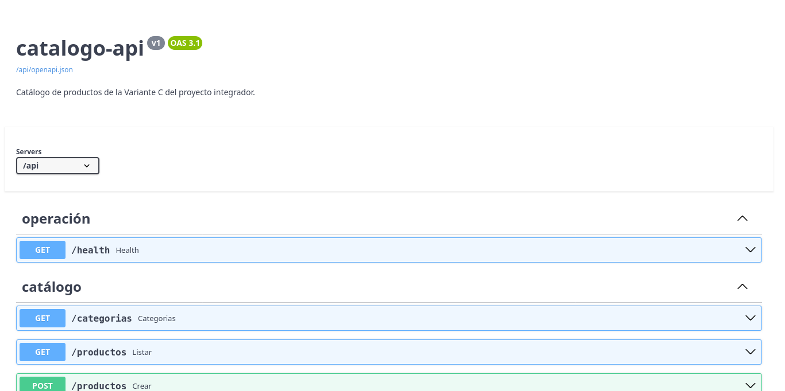

# Informe de Funcionamiento — `catalogo-app` (Variante C)

Este informe reúne la evidencia experimental del funcionamiento completo de **catalogo-app** en el clúster de Kubernetes, desplegado a partir del chart de Helm `./catalogo-app`. Cada sección incluye los comandos ejecutados, sus salidas reales y las capturas obtenidas. El desarrollo incremental paso a paso correspondiente a las entregas previas se encuentra documentado en la carpeta [`tp/`](tp/).

---

## Inventario de objetos desplegados en el clúster

Se verifica que la release de Helm despliegue exactamente los **12 objetos** definidos para la arquitectura en el namespace `catalogo-app` (3 `Deployment`, 3 `Service`, 2 `ConfigMap`, 1 `Secret`, 1 `PersistentVolumeClaim`, 1 `Ingress` y 1 `HorizontalPodAutoscaler`), sin incluir el servicio `NodePort` provisorio utilizado para depuración en el TP6:

```bash
kubectl get deploy,svc,cm,secret,pvc,ingress,hpa -n catalogo-app
```

```text
NAME                                READY   UP-TO-DATE   AVAILABLE   AGE
deployment.apps/catalogo-api        2/2     2            2           28m
deployment.apps/catalogo-db         1/1     1            1           28m
deployment.apps/catalogo-frontend   2/2     2            2           28m

NAME                        TYPE        CLUSTER-IP      EXTERNAL-IP   PORT(S)          AGE
service/catalogo-api        ClusterIP   10.98.95.106    <none>        8000/TCP         28m
service/catalogo-db         ClusterIP   10.96.191.122   <none>        27017/TCP        28m
service/catalogo-frontend   NodePort    10.103.163.10   <none>        8080:30302/TCP   28m

NAME                                 DATA   AGE
configmap/catalogo-api-config        5      28m
configmap/catalogo-frontend-config   2      28m
configmap/kube-root-ca.crt           1      28m

NAME                                        TYPE                 DATA   AGE
secret/catalogo-db-secret                   Opaque               2      28m
secret/sh.helm.release.v1.catalogo-app.v1   helm.sh/release.v1   1      28m
secret/sh.helm.release.v1.catalogo-app.v2   helm.sh/release.v1   1      19m
secret/sh.helm.release.v1.catalogo-app.v3   helm.sh/release.v1   1      18m

NAME                                    STATUS   VOLUME                                     CAPACITY   ACCESS MODES   STORAGECLASS   VOLUMEATTRIBUTESCLASS   AGE
persistentvolumeclaim/catalogo-db-pvc   Bound    pvc-965e1c90-5df0-4949-9b79-46a900dc1b07   1Gi        RWO            local-path     <unset>                 28m

NAME                                             CLASS   HOSTS            ADDRESS         PORTS   AGE
ingress.networking.k8s.io/catalogo-app-ingress   nginx   catalogo.local   172.16.21.212   80      28m

NAME                                                   REFERENCE                 TARGETS       MINPODS   MAXPODS   REPLICAS   AGE
horizontalpodautoscaler.autoscaling/catalogo-api-hpa   Deployment/catalogo-api   cpu: 2%/50%   2         6         2          28m
```

---

## 1. Aplicación respondiendo a través del Ingress con producto cargado e imagen

Se comprobó la resolución del host `catalogo.local` hacia la dirección asignada al `Ingress` (`172.16.21.212`), el enrutamiento hacia el backend mediante el proxy `/api/` y la creación de un producto nuevo (**SKU `777001` — Auriculares Sony WH-1000XM5 (Entrega Final)**) con imagen JPEG almacenada en MongoDB:

```bash
kubectl get ingress -n catalogo-app
grep catalogo.local /etc/hosts
curl -s http://catalogo.local/api/health
curl -s "http://catalogo.local/api/productos?q=777001"
curl -sD - -o /dev/null "http://catalogo.local/api/productos/6afe524e75be5199da8c9d0c/imagen?v=8fe8f3ae31568ac4"
```

```text
NAME                   CLASS   HOSTS            ADDRESS         PORTS   AGE
catalogo-app-ingress   nginx   catalogo.local   172.16.21.212   80      25m

172.16.21.212 catalogo.local

{"status":"ok","db":"ok","version":"v1"}

[{"sku":777001,"nombre":"Auriculares Sony WH-1000XM5 (Entrega Final)","precio":450000.0,"categoria":"Audio","stock":15,"descripcion":"Producto cargado a traves del Ingress catalogo.local para el informe final.","imagen_tipo":"image/jpeg","imagen_hash":"8fe8f3ae31568ac4","creado_en":"2026-11-19T01:35:10.539000","id":"6afe524e75be5199da8c9d0c","imagen":true}]

HTTP/1.1 200 OK
Server: nginx/1.31.6
Date: Thu, 19 Nov 2026 02:17:31 GMT
Content-Type: image/jpeg
Content-Length: 306844
Connection: keep-alive
etag: "8fe8f3ae31568ac4"
cache-control: public, max-age=86400
```

### Captura del catálogo en el navegador (`http://catalogo.local`)


En la captura se observa el indicador de estado en verde (`API v1`), el contador actualizado a `13 productos` (los 12 productos de demostración más el producto agregado) y la tarjeta correspondiente a **Auriculares Sony WH-1000XM5 (Entrega Final)** en la categoría `AUDIO`, con su imagen servida desde `/api/productos/{id}/imagen`.

### Captura de Swagger UI detrás del Ingress (`http://catalogo.local/api/docs`)



La interfaz de Swagger UI carga correctamente sobre `/api/docs` resolviendo `/api/openapi.json`, lo que confirma que la variable `ROOT_PATH=/api` definida en `catalogo-api-config` se propaga adecuadamente hasta FastAPI.

---

## 2. Comportamiento del autoescalador horizontal bajo carga (`kubectl get hpa -w`)

Para evaluar el funcionamiento de `catalogo-api-hpa` (`minReplicas: 2`, `maxReplicas: 6`, objetivo `50%` sobre `requests.cpu: 100m`), se lanzaron tres Pods generadores de carga (`busybox`) consultando de manera continua el endpoint `/productos/$PROD_ID/imagen`:

```bash
PROD_ID=$(curl -s http://catalogo.local/api/productos | python3 -c "import sys,json; print(json.load(sys.stdin)[0]['id'])")
for i in 1 2 3; do
  kubectl run carga-$i -n catalogo-app --image=busybox --restart=Never -- \
    /bin/sh -c "while true; do wget -q -O- http://catalogo-api:8000/productos/$PROD_ID/imagen > /dev/null; done"
done
```

Durante el pico de demanda, `kubectl top pods -n catalogo-app` registró el consumo distribuido entre las 6 réplicas activas de la API mientras `catalogo-frontend` se mantuvo en `1m` de CPU:

```bash
kubectl top pods -n catalogo-app
```

```text
NAME                                 CPU(cores)   MEMORY(bytes)
carga-1                              187m         4Mi
carga-2                              188m         1Mi
carga-3                              203m         1Mi
catalogo-api-779fd8c999-2sl6l        132m         40Mi
catalogo-api-779fd8c999-2x22x        185m         40Mi
catalogo-api-779fd8c999-bsrlc        156m         41Mi
catalogo-api-779fd8c999-d954n        123m         40Mi
catalogo-api-779fd8c999-jvt8k        120m         40Mi
catalogo-api-779fd8c999-zcn5s        111m         44Mi
catalogo-db-7956b7cff6-6d77w         169m         124Mi
catalogo-frontend-664966f46b-2znjq   1m           3Mi
catalogo-frontend-664966f46b-6t8rs   1m           3Mi
```

Posteriormente se eliminaron los Pods generadores de carga (`kubectl delete pod carga-1 carga-2 carga-3 -n catalogo-app`) y se mantuvo el monitoreo continuo hasta completarse la ventana de estabilización de 5 minutos (`stabilizationWindowSeconds: 300`):

```bash
kubectl get hpa -n catalogo-app -w
```

```text
NAME               REFERENCE                 TARGETS       MINPODS   MAXPODS   REPLICAS   AGE
catalogo-api-hpa   Deployment/catalogo-api   cpu: 2%/50%   2         6         2          20m
catalogo-api-hpa   Deployment/catalogo-api   cpu: 211%/50%   2         6         2          21m
catalogo-api-hpa   Deployment/catalogo-api   cpu: 276%/50%   2         6         4          21m
catalogo-api-hpa   Deployment/catalogo-api   cpu: 183%/50%   2         6         6          21m
catalogo-api-hpa   Deployment/catalogo-api   cpu: 137%/50%   2         6         6          22m
catalogo-api-hpa   Deployment/catalogo-api   cpu: 121%/50%   2         6         6          22m
catalogo-api-hpa   Deployment/catalogo-api   cpu: 119%/50%   2         6         6          22m
catalogo-api-hpa   Deployment/catalogo-api   cpu: 112%/50%   2         6         6          22m
catalogo-api-hpa   Deployment/catalogo-api   cpu: 16%/50%    2         6         6          23m
catalogo-api-hpa   Deployment/catalogo-api   cpu: 2%/50%     2         6         6          23m
catalogo-api-hpa   Deployment/catalogo-api   cpu: 1%/50%     2         6         6          26m
catalogo-api-hpa   Deployment/catalogo-api   cpu: 2%/50%     2         6         6          26m
catalogo-api-hpa   Deployment/catalogo-api   cpu: 1%/50%     2         6         6          27m
catalogo-api-hpa   Deployment/catalogo-api   cpu: 2%/50%     2         6         2          28m
```

La traza muestra la transición desde el estado base (`2%/50%`, `2` réplicas) hacia el límite superior (`211%`, `276%`, escalando `2 → 4 → 6` réplicas). Una vez retirada la carga, la utilización cae a `1–2%` y, transcurridos los 5 minutos de estabilización (`AGE 23m` a `28m`), el controlador reduce las réplicas nuevamente a `2`.

---

## 3. Ciclo de vida completo de la release de Helm (`helm history`)

Se ejecutó la instalación inicial (`v1`), la actualización de la API a `v2` (`helm upgrade catalogo-app ./catalogo-app -n catalogo-app --set api.image.tag=v2`) y la reversión a la primera revisión (`helm rollback catalogo-app 1 -n catalogo-app`):

```bash
helm history catalogo-app -n catalogo-app
```

```text
REVISION	UPDATED                 	STATUS    	CHART             	APP VERSION	DESCRIPTION     
1       	Wed Nov 18 22:13:42 2026	superseded	catalogo-app-0.1.0	v1         	Install complete
2       	Wed Nov 18 22:22:35 2026	superseded	catalogo-app-0.1.0	v1         	Upgrade complete
3       	Wed Nov 18 22:23:46 2026	deployed  	catalogo-app-0.1.0	v1         	Rollback to 1   
```

El historial confirma las tres revisiones: instalación inicial (`1`), actualización a `v2` (`2`) y reversión controlada a la revisión 1 (`3`, actualmente en estado `deployed`).

---

## 4. Verificación de parametrización efectiva en `values.yaml` (`helm template`)

Se validó la sintaxis del chart mediante `helm lint` y se verificó que el renderizado completo genere exactamente 12 objetos:

```bash
helm lint ./catalogo-app
helm template catalogo-app ./catalogo-app | grep -c "^kind:"
```

```text
==> Linting ./catalogo-app
[INFO] Chart.yaml: icon is recommended

1 chart(s) linted, 0 chart(s) failed

12
```

A continuación se renderizaron las plantillas `templates/deploy-catalogo-api.yaml` y `templates/ingress-catalogo-app.yaml` con los valores por defecto y con valores sobrescritos mediante `--set`:

```bash
helm template catalogo-app ./catalogo-app -s templates/deploy-catalogo-api.yaml | grep -E "replicas:|image:"
helm template catalogo-app ./catalogo-app -s templates/deploy-catalogo-api.yaml --set api.image.tag=v2 --set api.replicas=4 | grep -E "replicas:|image:"

diff -u \
  <(helm template catalogo-app ./catalogo-app -s templates/deploy-catalogo-api.yaml) \
  <(helm template catalogo-app ./catalogo-app -s templates/deploy-catalogo-api.yaml --set api.image.tag=v2 --set api.replicas=4)

helm template catalogo-app ./catalogo-app -s templates/ingress-catalogo-app.yaml | grep "host:"
helm template catalogo-app ./catalogo-app -s templates/ingress-catalogo-app.yaml --set ingress.host=catalogo.produccion.local | grep "host:"
```

```diff
--- /dev/fd/63
+++ /dev/fd/62
@@ -6,7 +6,7 @@
   name: catalogo-api
   namespace: catalogo-app
 spec:
-  replicas: 2
+  replicas: 4
   selector:
     matchLabels:
       app: catalogo-api
@@ -17,7 +17,7 @@
     spec:
       containers:
         - name: catalogo-api
-          image: "keze87/catalogo-api:v1"
+          image: "keze87/catalogo-api:v2"
           imagePullPolicy: IfNotPresent
           ports:
             - containerPort: 8000
```

```text
    - host: "catalogo.local"
    - host: "catalogo.produccion.local"
```

La comparación de salida muestra que los parámetros `api.replicas`, `api.image.tag` e `ingress.host` modifican efectivamente los manifiestos generados por Helm.

---

## 5. Aislamiento del sistema de archivos entre réplicas (prueba del TP6)

Esta verificación respalda la respuesta de la sección 2 de [`ARQUITECTURA.md`](ARQUITECTURA.md#2-pregunta-propia-de-la-variante-c-transición-de-una-a-tres-réplicas-de-la-api). Con múltiples réplicas activas de `catalogo-api`, se comprobó el balanceo de 10 peticiones HTTP consecutivas y posteriormente se escribió `/tmp/foto.bin` en uno de los Pods para verificar su visibilidad desde otras réplicas:

```bash
kubectl get pods -l app=catalogo-api -n catalogo-app

for i in $(seq 1 10); do
  curl -s -o /dev/null -w "%{http_code} " http://catalogo.local/api/productos
done
echo ""

POD_A=$(kubectl get pods -l app=catalogo-api -n catalogo-app -o jsonpath='{.items[0].metadata.name}')
POD_B=$(kubectl get pods -l app=catalogo-api -n catalogo-app -o jsonpath='{.items[1].metadata.name}')
POD_C=$(kubectl get pods -l app=catalogo-api -n catalogo-app -o jsonpath='{.items[2].metadata.name}')

kubectl exec "$POD_A" -n catalogo-app -c catalogo-api -- sh -c 'echo prueba > /tmp/foto.bin; ls -l /tmp/foto.bin'
kubectl exec "$POD_B" -n catalogo-app -c catalogo-api -- ls -l /tmp/foto.bin
kubectl exec "$POD_C" -n catalogo-app -c catalogo-api -- ls -l /tmp/foto.bin
```

```text
NAME                            READY   STATUS    RESTARTS   AGE
catalogo-api-779fd8c999-2sl6l   1/1     Running   0          4m17s
catalogo-api-779fd8c999-2x22x   1/1     Running   0          4m2s
catalogo-api-779fd8c999-bsrlc   1/1     Running   0          15m
catalogo-api-779fd8c999-d954n   1/1     Running   0          4m17s
catalogo-api-779fd8c999-jvt8k   1/1     Running   0          4m2s
catalogo-api-779fd8c999-zcn5s   1/1     Running   0          15m

200 200 200 200 200 200 200 200 200 200

-rw-r--r-- 1 appuser appuser 7 Nov 19 01:39 /tmp/foto.bin
ls: cannot access '/tmp/foto.bin': No such file or directory
command terminated with exit code 2
ls: cannot access '/tmp/foto.bin': No such file or directory
command terminated with exit code 2
```

Las 10 consultas respondieron `200`, pero el archivo `/tmp/foto.bin` creado en `POD_A` no existe en `POD_B` ni en `POD_C`, demostrando el aislamiento del sistema de archivos efímero entre réplicas y justificando la persistencia de imágenes en MongoDB.
